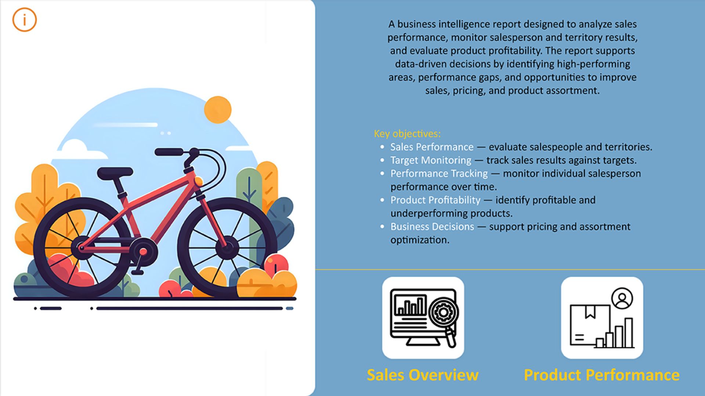
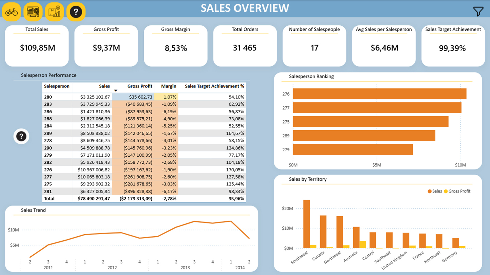
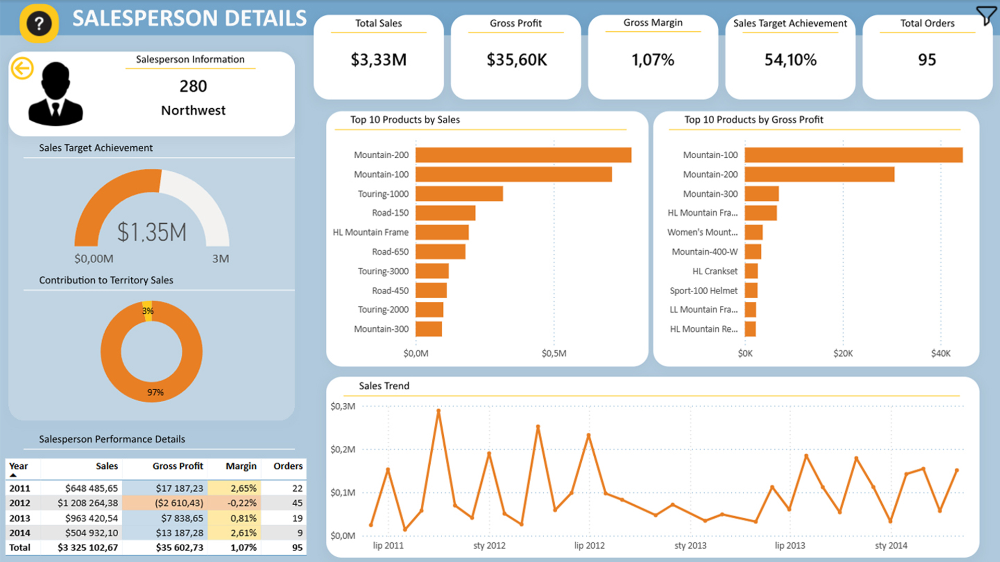
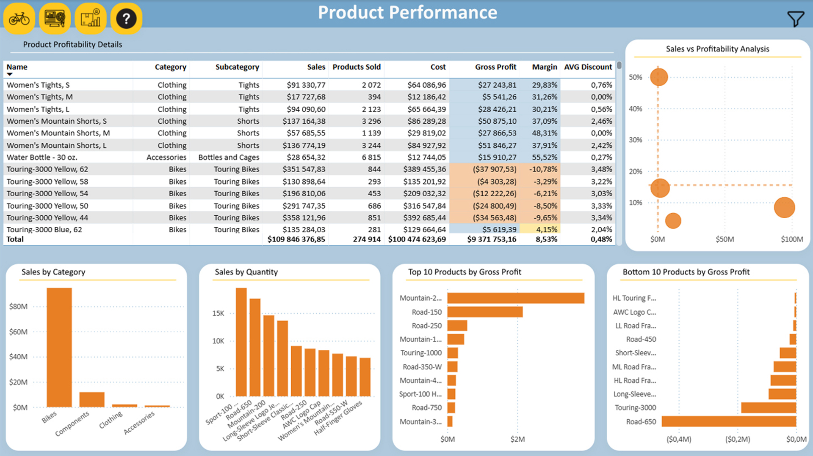

# Sales Performance & Product Profitability Analysis for a Bike Store
An interactive Power BI dashboard designed to help sales managers monitor sales performance, target achievement, regional results, and product profitability.

## Interactive Dashboard

[**View Interactive Power BI Report**](https://app.powerbi.com/view?r=eyJrIjoiNzk5Nzc5NDgtZGZkMy00NTc1LTkzMzAtODdhOWNhNDUxZTFjIiwidCI6IjNkZmU5YWI2LTgxYmYtNDkxYy1iNjcwLTAxYzgyNGEwOWUxOSJ9)

## Dashboard Preview

### Landing Page

### Sales Overview

### Salesperson Details

### Product Performance

## Goal 
Help sales managers monitor sales performance and target achievement, compare results across salespeople and regions, and identify products with high or low profitability to support informed business decisions.

## Tools
Power BI · Power Query · DAX · M · CSV

## Model
Star/Snowflake hybrid 

## Data Preparation
-	Importing and transforming CSV files in Power Query
-	Creating a folder path parameter for data sources
-	Cleaning missing and invalid values
-	Removing unnecessary and technical columns
-	Standardizing data types and handling conversion errors
-	Merging tables and preparing fact and dimension tables
-	Creating a calendar table
-	Preparing sales target data
-	Creating DAX measures for sales, cost, gross profit, gross margin, orders, quantity, discounts, target achievement, and salesperson share

## Visuals 
KPI cards · Bar & Line Charts · Gauge · Donut Chart · Scatter Plot · Tables · Drillthrough · Conditional Formatting 

## Key insight
-	High sales do not always mean high profitability.
-	Some products generate strong sales while maintaining low or negative margins.
-	Sales target achievement helps identify strong performers and employees who may need additional support.
-	Regional comparisons reveal differences in performance and potential opportunities for improvement.
-	Product profitability analysis can support pricing, discount, promotion, and assortment decisions.

## Business Recommendations
-	Review discounts on high-sales, low-margin products.
-	Reassess pricing for products with low or negative margins.
-	Evaluate low-sales, low-profitability products for potential assortment changes.
-	Promote high-margin products with lower sales.
-	Consider additional support or training for salespeople with low target achievement.
-	Use regional differences to identify growth opportunities.

[View Full Documentation (PDF)](README.pdf)
